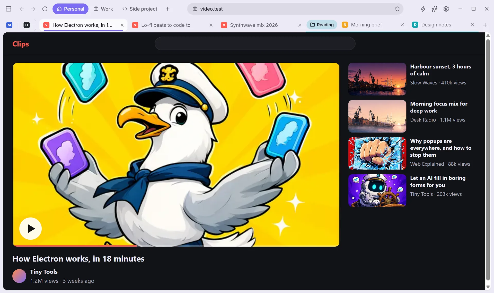
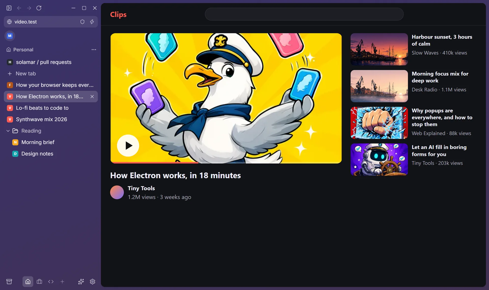
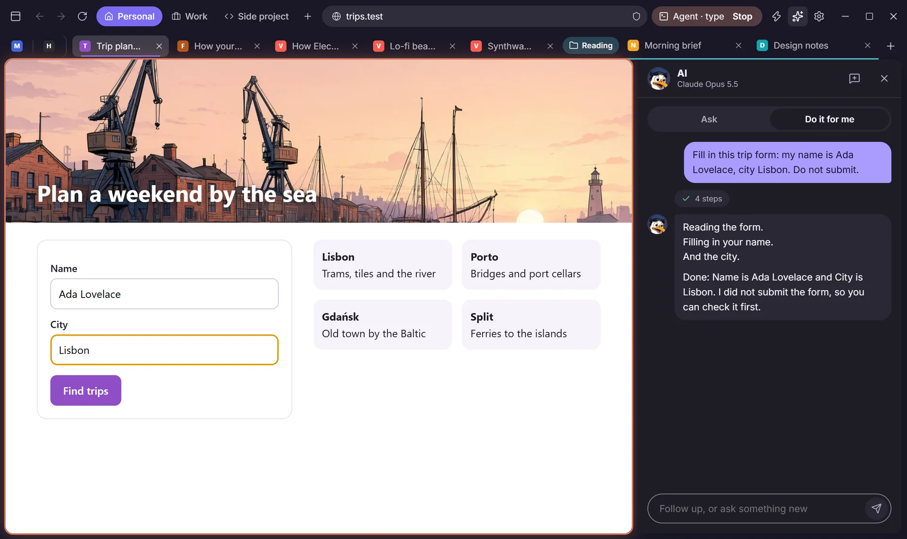

<p align="center">
  
</p>

<p align="center">
  <a href="https://github.com/Bambeek/solamar/releases/latest/download/Solamar-Setup.exe"><b>Download for Windows</b></a>
  &nbsp;·&nbsp;
  <a href="https://github.com/Bambeek/solamar/releases/latest/download/Solamar-arm64.dmg"><b>macOS, Apple silicon</b></a>
  &nbsp;·&nbsp;
  <a href="https://github.com/Bambeek/solamar/releases/latest/download/Solamar-x64.dmg">macOS, Intel</a>
  &nbsp;·&nbsp;
  <a href="https://solamar.app">solamar.app</a>
</p>

<p align="center">
  <a href="https://github.com/Bambeek/solamar/releases/latest"></a>
  <a href="LICENSE"></a>
  
</p>

The Browser Company ends Arc on December 22, 2026. Solamar keeps what Arc got right, like spaces, a vertical sidebar,
pinned tabs and folders, and brings your Arc sidebar over in one click. It also has an ad blocker built in, and an AI
agent that stays off until you switch it on. Solamar is free and open source. There is no account and no telemetry.

<p align="center">
  <picture>
    <source media="(prefers-color-scheme: dark)" srcset="site/assets/window-dark.webp">
    
  </picture>
</p>

## Moving out of Arc

- **Arc spaces, one click.** Solamar reads the sidebar file Arc keeps on your computer, without changing it. It brings
  over your spaces with their colours and icons, your pinned tabs and your folders. Nothing is uploaded.
- **Or from another browser.** It brings in bookmarks and history from the other browsers on your computer in one
  click. Passwords come in from the CSV file a browser or password manager exports.
- **Your layout.** Keep Arc's vertical sidebar, or switch to a top bar. Every tab shows its title and its own close
  button.

<p align="center">
  
</p>

## What's inside

<table>
  <tr><td><b>Spaces</b></td><td>Colours, pinned tabs, favorites and nested folders. Today's tabs archive themselves after 12 hours.</td></tr>
  <tr><td><b>Command bar</b></td><td>Press <kbd>Ctrl+T</kbd> to search, open a site, jump to a tab or run an action. You can change every shortcut.</td></tr>
  <tr><td><b>Split view and Peek</b></td><td>Put two pages side by side. Shift+click a link to open it over the page; keep it as a tab or press Esc.</td></tr>
  <tr><td><b>Zap and Boosts</b></td><td>Click a banner or popup to remove it for good. Boosts give any site your own colours, fonts and CSS.</td></tr>
  <tr><td><b>Ad blocking</b></td><td>On from the first launch, YouTube included. It uses an open-source engine and community filter lists. You can allow a site in one click.</td></tr>
  <tr><td><b>Passwords</b></td><td>Solamar offers to save a login when you sign in, and encrypts it with your system's keychain. It fills a password only on the site it belongs to.</td></tr>
  <tr><td><b>Chrome extensions</b></td><td>Add extensions from the Chrome Web Store. Before one goes in, Solamar tells you in plain words what it can do.</td></tr>
  <tr><td><b>Private spaces</b></td><td>A space that saves nothing: no history, no extensions, and no cookies after you close it.</td></tr>
  <tr><td><b>Light on memory</b></td><td>Tabs you have not looked at go to sleep. After a crash, your tabs come back with their history, scroll position and anything you were typing.</td></tr>
  <tr><td><b>Mini player</b></td><td>Play, pause and picture in picture for music in another tab, right in the top bar.</td></tr>
</table>

## AI, only if you want it

AI is off until you switch it on. Then you pick what runs each feature:

- a local model through [Ollama](https://ollama.com), so nothing leaves your computer;
- or Claude, on your own Anthropic API key, which Solamar keeps in your system's keychain.

<p align="center">
  
</p>

<p align="center">
  
</p>

- **Do it for me.** Tell the agent what to do on the page you are looking at, like filling in a form or collecting
  every address on a page. It shows each step, and you can stop it any time. It always waits for your click before it
  pays for anything. Settings > Claude Code > "How much it does on its own" makes it wait before sending, submitting
  or deleting too. It cannot type into password, card or one-time-code fields.
- **Draft a reply.** In a mail or chat box, press `Ctrl+Shift+Space`. It writes the reply in your voice and leaves it
  for you to send.
- **Ask about a page.** Press `Ctrl+J` to get the gist of a long page or ask a question about it.
- **Better search.** Press Tab in the command bar for a sharper search, or ask a question and get the answer in the bar.
- **Tidy tabs.** It suggests groups for today's tabs. Nothing moves until you apply them.

## Drive it from Claude Code

<p align="center">
  
</p>

Turn on Settings > Claude Code and Solamar starts an MCP server that only this computer can reach. The settings page
shows a `claude mcp add` line to run once in a terminal. Claude Code can then open tabs, read pages, click and type.
It works in its own Claude space, or in tabs you share with it ("Share with Claude Code"). It follows the same rules as
Solamar's own agent: payments wait for your click, and it never types passwords or card numbers. A pill in the top bar
shows when it is working, and you can stop it from there.

## A browser, not a service

- **No account.** There is nothing to create and nothing to sign in to.
- **No sync server.** Your tabs never pass through a server of ours.
- **No telemetry.** Solamar has no analytics and no usage tracking.
- **Your data stays on your computer.** Spaces, tabs and settings are one JSON file in the app data folder. Passwords
  and your API key are encrypted with your system's keychain. Imports only read your other browsers' files, and
  private spaces write nothing to disk.

## Installing

The installers are not code-signed yet:

- **Windows** may show "Windows protected your PC". Click More info, then Run anyway.
- **On a Mac**, open Solamar once, then go to System Settings > Privacy & Security and click Open Anyway.

The Windows app updates itself from [GitHub Releases](https://github.com/Bambeek/solamar/releases). The Mac app tells
you when a new version is out.

## Building from source

Solamar is built with Electron, React and TypeScript.

```bash
npm install
npm run dev
```

To run the production build, use `npm run build` and then `npm start`.

### Tests

```bash
npm test
npm run typecheck
```

The end-to-end tests run after `npm run build`. They use a hidden window and a throwaway profile, and make no real
API calls:

- `node tests/e2e/smoke.mjs <tmp-profile-dir> <screenshot-dir>` covers browsing, spaces, Arc import, and local AI
  against a mock Ollama.
- `node tests/e2e/agent.mjs <tmp-profile-dir> <screenshot-dir>` covers the Claude engine against a mock API, and the
  MCP server driven by the official MCP client.

### Layout

- `src/main`: the window and tab views (`browser.ts`), storage, ad blocking, AI, the MCP server (`agent.ts`) and the
  importers. `arc-parse.ts` is pure and tested.
- `src/preload`: the bridge for Solamar's own pages only. Web pages get no preload.
- `src/renderer`: the frame (sidebar, AI panel) and the overlay (command bar, dialogs).
- `site/`: the website at [solamar.app](https://solamar.app).
- `MODLOG.md`: Arc's on-disk format, for the importer.

### Releasing

1. Bump `version` in package.json and commit.
2. Tag the commit and push the tag: `git tag v0.1.1 && git push origin v0.1.1`.
3. CI (`.github/workflows/build.yml`) builds the Windows installer and both Mac disk images, tests the packaged apps,
   and uploads everything to a draft release.
4. Publish the draft. The apps' updater and the website only see published releases.

## Contributing

Issues and pull requests are welcome. If you are moving from Arc, the most useful thing you can tell us is which Arc
feature you miss.

## License

Solamar is licensed under GPL-3.0-or-later (see [LICENSE](LICENSE)). Chrome extension support comes from
[electron-chrome-extensions](https://github.com/samuelmaddock/electron-browser-shell), used under its GPL-3.0 option.
